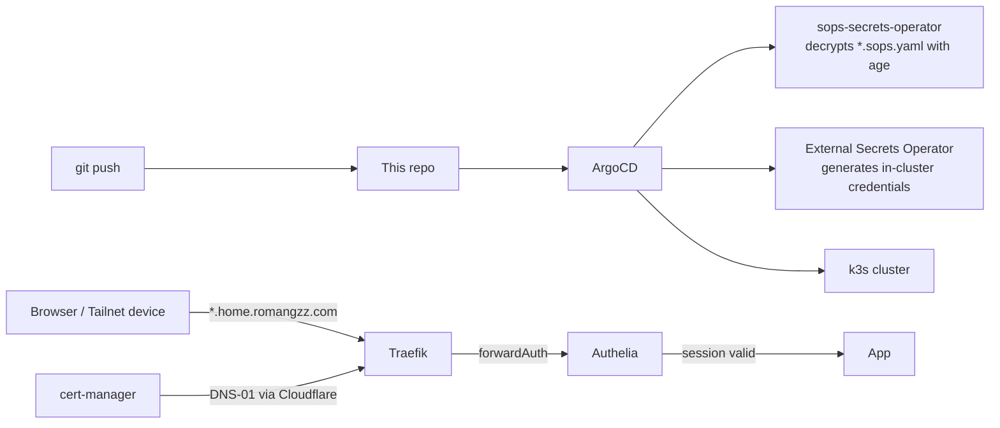

# homelab

A single-node k3s homelab, deployed entirely through ArgoCD from this repo. Media stack, local LLM serving, network management, monitoring, and workflow automation, all GitOps-managed with SSO in front of every admin surface and real TLS certificates throughout.

## Architecture



Everything in the cluster is declared here and reconciled by ArgoCD (`clusters/homelab` → `apps/argocd-apps` → one `Application` per app). Secrets are never plaintext in git. Values that come from outside (tokens, API keys, passwords) are `SopsSecret` resources in `*.sops.yaml` files, encrypted client-side with [sops](https://github.com/getsops/sops) + age (only the values; key names stay readable) and decrypted in-cluster by sops-secrets-operator. Internal random credentials (e.g. Plane's database passwords) are generated in-cluster by External Secrets Operator and never exist in git at all. See [docs/secrets-migration.md](docs/secrets-migration.md). TLS is a single wildcard cert from Let's Encrypt (DNS-01 via Cloudflare), registered as Traefik's default certificate, so every app gets real HTTPS with no per-app cert config. Apps with no login of their own sit behind Authelia via a Traefik `forwardAuth` middleware, enforced at the proxy. Apps that ship their own login (ArgoCD, Plane, qBittorrent, Omada) are exposed directly and rely on it, so there's no double login.

## Apps

| App | Namespace | Host | Notes |
|---|---|---|---|
| Jellyfin | `media` | `jellyfin.home.romangzz.com` | Media server |
| Seerr | `media` | `seerr.home.romangzz.com` | Request portal for trending/popular content, feeds Radarr/Sonarr |
| qBittorrent | `media` | `qbittorrent.home.romangzz.com` | Torrent client, routed through a VPN sidecar (gluetun) |
| Radarr / Sonarr / Bazarr / Prowlarr | `media` | `{radarr,sonarr,bazarr,prowlarr}.home.romangzz.com` | Media/subtitle/indexer management (radarr/sonarr manage the FHD/1080p tier) |
| Radarr UHD / Sonarr UHD | `media` | `{radarr-uhd,sonarr-uhd}.home.romangzz.com` | Second instances for the UHD quality tier; own root folders (`movies-uhd`/`tv-uhd`), same media-pvc |
| Unpackerr | `media` | — | Extracts completed downloads; egress-restricted (no internet access needed) |
| Cleanuparr | `media` | `cleanuparr.home.romangzz.com` | Removes stalled/blocked downloads, triggers blocklist + re-search |
| ISO Extractor | `media` | `iso-extractor.home.romangzz.com` | Rips ISOs to MKV; egress-restricted |
| Subgen / Whisper | `media` | `{subgen,whisper}.home.romangzz.com` | Local subtitle generation / ASR |
| ntfy | `media` | `ntfy.home.romangzz.com` | Push notifications for Sonarr/Radarr/Bazarr failures |
| Open WebUI | `ai` | `chat.home.romangzz.com` | Chat UI for local models |
| Ollama | `ai` | `ollama.home.romangzz.com` | Local LLM serving (GPU) |
| Hermes Agent | `ai` | `hermes.home.romangzz.com` | Messaging/cron agent gateway |
| Plane | `plane` | `plane.home.romangzz.com` | Task planner (PRD/architecture pages, sprints) for the [autonomous agent process](docs/agent-process.md) |
| ArgoCD | `argocd` | `argo.home.romangzz.com` | GitOps |
| Grafana / Loki / Alloy | `monitoring` | `grafana.home.romangzz.com` | Metrics + logs (kube-prometheus-stack + Loki) |
| Omada Controller | `omada` | `omada.home.romangzz.com` | Network/AP management |
| Tailscale | `tailscale` | — | Subnet router + exit node |
| n8n | `n8n` | `n8n.home.romangzz.com` (internal), `n8n.romangzz.com` (public, via Cloudflare Tunnel) | Workflow automation |
| Authelia | `auth` | `auth.home.romangzz.com` | SSO login portal |
| Homepage | `dashboard` | `home.romangzz.com` | Single entry point linking everything above |
| cert-manager, sops-secrets-operator, External Secrets Operator, nvidia-device-plugin | `cert-manager`, `kube-system`, `sops-secrets-operator`, `external-secrets` | — | Cluster infrastructure, no UI |

## Prerequisites

- A k3s cluster with ArgoCD installed and bootstrapped to sync from this repo (`clusters/homelab`).
- The **sops age key** loaded into the cluster once, so sops-secrets-operator can decrypt `*.sops.yaml` (see [docs/secrets-migration.md](docs/secrets-migration.md)). It is the one secret that can never live in this repo: it's in 1Password (vault *Homelab*, item `homelab-sops-age-key`), and locally at `~/.config/sops/age/keys.txt` for editing:
  ```
  op document get homelab-sops-age-key --vault Homelab \
    | ssh <server> '{ sudo k3s kubectl create namespace sops-secrets-operator </dev/null || true; } \
      && sudo k3s kubectl -n sops-secrets-operator create secret generic sops-age-key --from-file=keys.txt=/dev/stdin'
  ```
  This needs passwordless `sudo` on the server (stdin carries the key, so `sudo` can't prompt). Otherwise `ssh` in interactively, run the same two `kubectl` commands, and paste the key (`op document get homelab-sops-age-key --vault Homelab` locally) into the second one, ending with Ctrl-D.
- The **containerd AppArmor profile override** at `/etc/apparmor.d/cri-containerd.apparmor.d` (copy of [`docs/host/cri-containerd.apparmor.d`](docs/host/cri-containerd.apparmor.d)). Without it, signals between processes inside a container are denied on this host (Ubuntu 26.04, AppArmor 5): `gosu`-based images hang and Postgres can't manage its own processes. Install it before k3s starts its first container:
  ```
  sudo install -m 0644 docs/host/cri-containerd.apparmor.d /etc/apparmor.d/cri-containerd.apparmor.d
  sudo apparmor_parser -r /etc/apparmor.d/cri-containerd.apparmor.d
  ```
- `sops` and `age` locally, to create or edit a secret. `.sops.yaml` has the creation rules, so any `apps/**/*.sops.yaml` encrypts automatically:
  ```
  sops apps/<app>/<name>.sops.yaml   # opens decrypted, re-encrypts on save
  ```
  Enable the plaintext guard once per clone: `git config core.hooksPath .githooks`.
- A Cloudflare account with the DNS zone for your domain, for cert-manager's DNS-01 challenge and (separately) the n8n tunnel.
- Internal DNS (this repo assumes Omada LAN DNS + Tailscale Split DNS) resolving `*.home.<yourdomain>` to the cluster node.

## CI

Every push and PR runs [`.github/workflows/validate.yml`](.github/workflows/validate.yml): every `kustomization.yaml` in the repo is built and schema-validated in strict mode, the tree is scanned for accidentally-committed plaintext secrets with gitleaks, and [`check-sops-encrypted.sh`](.github/scripts/check-sops-encrypted.sh) fails on any `*.sops.yaml` that isn't actually encrypted or any plain `Secret` with data. [Renovate](renovate.json) opens PRs for outdated image tags and Helm chart versions.

## License

MIT — see [LICENSE](LICENSE).
